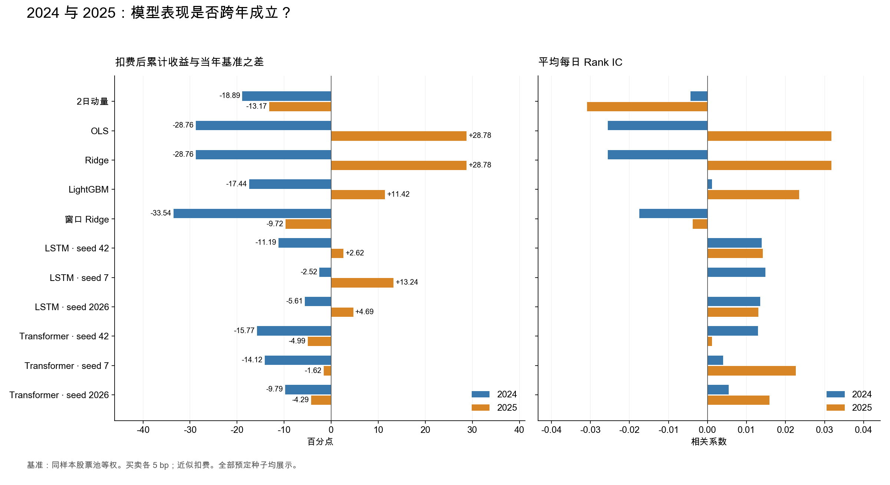
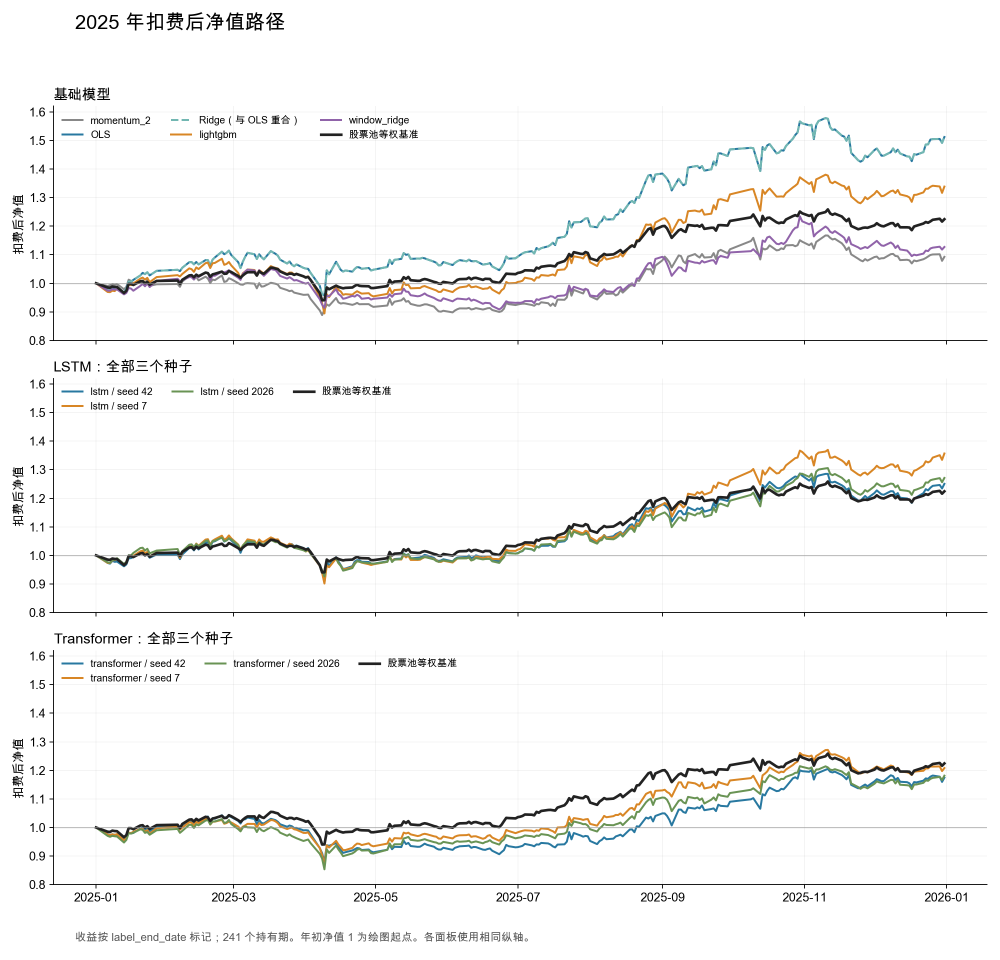

# A股机器学习收益预测与组合评价

比较简单线性模型、树模型与序列模型能否从量价特征中学习次日选股信息，以及这种预测能力在换手和交易成本之后能否转化为相对收益。

项目包括逐日历史股票池、数据核查、特征与标签、时间切分、模型训练、共同样本评价和组合成本分析。数据来自聚宽。研究区间为2020—2025年，2019年第四季度用于计算起始窗口。

**主要结果：2024年所有模型组合扣费后均落后股票池等权基准；2025年OLS/Ridge、LightGBM及三个LSTM种子超过基准，三个Transformer种子仍落后。复杂模型没有表现出跨年一致优势。** 这些是固定配置下的研究结果，尚不能证明稳定、可交易的Alpha。

## 先看什么

- [两年结果与研究结论](docs/research_report.md)：净收益、风险、年度差异及结论边界。
- [01_data.ipynb](01_data.ipynb)：从聚宽接口获取数据，生成一张建模表。
- [02_models.ipynb](02_models.ipynb)：按年份训练、预测和评价，包含六类图表。

## 研究设定

信号在交易日 t 收盘后产生，用于选择下一交易日开盘的持仓。标签为：

$$y_{i,t}=\frac{O^{adj}_{i,t+2}}{O^{adj}_{i,t+1}}-1$$

其中 t+1、t+2 按交易日计算。复权价格用于计算收益，不是实际委托价格。最后一个信号日即使缺少未来标签，仍可预测，只是不能进入已实现收益评价。

| 环节 | 本项目口径 |
|---|---|
| 股票池 | 每日历史沪深300成员；历年并集只决定下载哪些股票 |
| 单日输入 | 2日动量、5日动量、最近5个单日收益的波动率、当日成交量/此前5日均量、日内收益 |
| 序列输入 | 截至信号日的20×5窗口；同一股票、连续交易日、特征完整 |
| 时间切分 | 2024：2020—2023训练；2025：2020—2024重新训练 |
| 边界处理 | 训练样本的标签结束日不得越过训练截止日；预处理参数只从训练区间估计 |
| 模型 | OLS、Ridge、LightGBM、窗口Ridge、LSTM、小型Transformer；另设动量分数参照 |
| 随机性 | LSTM与Transformer各运行42、7、2026三个种子，每次固定3轮 |
| 公平比较 | 所有模型和基准使用相同评价行；单日模型与序列模型的合法训练行不完全相同 |
| 组合 | 每日最高分五分位等权；基准为共同可评价股票池等权，非官方沪深300收益 |
| 成本 | 权重先随收益漂移，再计算买卖交易量；每侧5bp，近似净收益=毛收益−成本 |
| 风险评价 | Rank IC、分组收益、累计收益、回撤、波动率、Sharpe、换手和成本敏感性 |

2024用于开发与模型比较；2025曾作为后续评价年，但结果已经查看。本仓库整理的是既有实验的复现，不能再把2025称为尚未接触的盲测集。后续根据2025修改配置，应记录为探索。

## 累计净收益

以下均为评价区间累计收益，采用每侧5bp的成本假设，未年化。最后一列是两个累计收益的算术差，不是独立超额组合净值。

| 模型/分数 | 2024净收益 | 2025净收益 | 2025减基准（百分点） |
|---|---:|---:|---:|
| momentum_2 | 0.46% | 9.26% | -13.17 |
| ols | -9.42% | 51.20% | +28.78 |
| ridge | -9.42% | 51.20% | +28.78 |
| lightgbm | 1.90% | 33.85% | +11.42 |
| window_ridge | -14.20% | 12.71% | -9.72 |
| lstm_seed42 | 8.15% | 25.04% | +2.62 |
| lstm_seed7 | 16.83% | 35.67% | +13.24 |
| lstm_seed2026 | 13.74% | 27.11% | +4.69 |
| transformer_seed42 | 3.58% | 17.44% | -4.99 |
| transformer_seed7 | 5.22% | 20.81% | -1.62 |
| transformer_seed2026 | 9.55% | 18.14% | -4.29 |
| universe_equal_weight | 19.34% | 22.42% | +0.00 |

完整数字：[2024汇总](results/2024/summary.csv)、[2025汇总](results/2025/summary.csv)、[2025净值](results/2025/net_nav.csv)。全部预定种子均保留，没有按收益选择最好的一次。

## 运行

1. 将两本notebook放在聚宽研究环境的同一目录。需要能调用相应日期范围数据的聚宽账号。
2. 从头运行`01_data.ipynb`，生成`data/ml_alpha_simple/model_data.csv.gz`。若已有本版本生成的这张表，可直接使用。
3. 关闭01的内核以释放内存。打开02，设`YEAR=2024`，从头运行；结果写入`data/ml_alpha_simple/results_2024/`。
4. 保存2024结果后，重启02内核，将`YEAR`改为2025，从头运行；结果写入`results_2025/`。上传的已执行版本使用2025，整理版保留该默认值。

两次运行都会重新训练。读本仓库已有图表和结果不需要再训练。原实验运行于Python 3.6.7、CPU；完整依赖版本和本地复现限制见[运行说明](docs/reproduction.md)。仓库不附带原始行情，Notebook里的`jqdata`依赖聚宽环境。

## 结论范围

- 当前组合假设能在开盘成交，未完整实现停牌、涨跌停、现金、整手数量、冲击和公司行动的逐笔账户处理；期末不额外清仓。
- 全部评价行要求未来标签可用，因此这是可评价样本上的理论比较。信号资格没有使用未来停牌信息，但样本筛选仍不等同于真实订单执行。
- 20日窗口完整性筛选会改变共同基准的成分。没有控制行业、规模或其他风格暴露，超额收益不能直接解释为纯Alpha。
- 两年结果、三个随机种子不能证明长期稳定。2025年OLS收益较高，同时波动和最大回撤也高于基准。

这些限制保留在报告中。项目的价值在于完整呈现问题、比较条件、结果和证据边界，而不是只展示最好的一条净值曲线。
